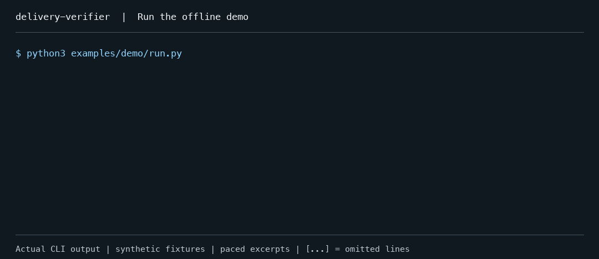

# delivery-verifier

**Prove this regression test really catches the old bug.**

Keep the new tests, run them against the old code, then run them with the fix:

```sh
dv prove --test "<command>"
```

Use a direct unittest, pytest, node:test (TAP), or Vitest **3.2.x or exactly 4.1.12** command.

**GitHub Action summary** — rendered locally by the Action adapter from the [synthetic proof below](#synthetic-example); this is not a hosted CI run:

```text
dv prove: PASS

- Red: pass (exit 1, normal)
- Green: pass (exit 0, normal)

Assertion-only red failure and executed green pass.
```

[Install](#quick-start) · [GitHub Actions](#github-actions) · [Real-world example](#real-world-example) · [简体中文](README.zh-CN.md)

## Quick start

Requirements: Python 3.10–3.13 with `venv` and `pip`, Git 2.38+, Linux/macOS. Some Linux distributions package `venv` separately (for example, `python3-venv`).

Install the **v0.4.0 GitHub Release wheel** with [pipx](https://pipx.pypa.io/latest/how-to/install-pipx.html):

```sh
pipx install https://github.com/clean99/delivery-verifier/releases/download/v0.4.0/delivery_verifier-0.4.0-py3-none-any.whl
pipx ensurepath
```

Open a new shell after `pipx ensurepath`, then check the installed CLI:

```sh
dv --version
dv prove --help
```

For uv, a Python virtual environment, or installation from the Git tag, see [installation options](#installation-options). These recipes use GitHub assets or source, not PyPI.

In **your project's repository**, with the fix and regression test committed on a branch based on local `main`, run:

```sh
dv prove --test "python -m unittest discover -s tests -p test_words.py -v"
```

No item file or JSON editing is needed. Red runs at the merge base of `main` and `HEAD` with head's tests retained; green runs at `HEAD`, in a separate detached worktree. The command requires an assertion-only red failure and a complete green report with at least one passed test body. It rejects a hollow assertion, a runtime/import failure, zero executed green, and all-skipped green. Node TAP file-only successes do not count as passed test bodies. On Node 20, TAP cannot distinguish those from top-level tests named with absolute paths, so such names are conservatively excluded too; use descriptive test names.

Use `--base REF --head REF` to select committed revisions, `--test-file checks/regression.py` for a custom pure test file, and `--json` for machine-readable output. Other supported recipes:

```sh
dv prove --test "python -m pytest --tb=long tests/test_words.py"
dv prove --test "node --test --test-reporter=tap tests/words.test.cjs"
dv prove --test "vitest run tests/words.test.js"
```

**Vitest scope:** a PASS does not establish that a product module was fixed. Files read by plugins but not reported by Vite count as part of the change under test; see the [runner contract](#focused-runner-contract).

## Synthetic example

This small teaching fixture changes `text.split(" ")` to `text.split()`. The assertion checks that repeated spaces produce `["red", "green"]`. It uses Python's built-in unittest runner and needs no project dependencies.

<details>
<summary>Reproduce in a new directory</summary>

Install dv above, keep that environment active, and replace `<example>` with a new directory. Git commits use your configured author identity.

```sh
git init -b main "<example>"
cd "<example>"
printf 'def split_words(text):\n    return text.split(" ")\n' > words.py
git add words.py
git commit -m "Handle single spaces"
git switch -c fix-spaces

printf 'def split_words(text):\n    return text.split()\n' > words.py
mkdir tests
cat > tests/test_words.py <<'PY'
import unittest
from words import split_words


class WordTests(unittest.TestCase):
    def test_repeated_spaces(self):
        self.assertEqual(split_words("red   green"), ["red", "green"])
PY
git add words.py tests/test_words.py
git commit -m "Split repeated spaces"
dv prove --test "python -m unittest discover -s tests -p test_words.py -v"
```

</details>

Actual output excerpts from the **v0.3.0 release wheel**, Python **3.12.13**, on macOS:

```text
prove: PASS
[PASS] red assertion: unittest: red failed at assertions with no runner errors
[PASS] green execution: unittest: complete=True, tests={'executed': 1, 'passed': 1, 'failed': 0, 'skipped': 0}; requires a normal exit 0 and at least one passed test body, with no errors
```

Red exited 1 with `AssertionError: Lists differ: ['red', '', '', 'green'] != ['red', 'green']`; green exited 0 with one passed test. The proof writes `proof.json`, `red.log` and `green.log` to the evidence directory printed by the CLI. The summary at the top uses this same run.

## Real-world example

**PASS on a real upstream fix.** [Phoenix #17270](https://github.com/Arize-ai/phoenix/pull/17270), authored by clean99 and merged on 2026-10-26, preserves `extra_body` when converting a saved prompt to SDK arguments. Its pytest regression method covers metadata, sampling overrides and empty values.

The 2026-10-28 rerun used dv **0.3.1 installed from source**, with the code at `60b309e41bcd7e75fac876063e27b303782ef016`, on macOS with Python **3.12.13**. `dv prove` exited **0**. Actual output, with only the machine-specific evidence path replaced:

```text
prove: PASS
HEAD deb0731a4606b77c786d86953301ecca39916829 base abbfa7bd3ecc5c82cd17c112713f972b0052db4e
Committed snapshots only; not a security sandbox or delivery approval.
Evidence: <evidence-dir>
hygiene: not_requested
review: not_requested
[PASS] red assertion: pytest: red failed at assertions with no runner errors
[PASS] green execution: pytest: complete=True, tests={'executed': 6, 'passed': 6, 'failed': 0, 'skipped': 0, 'xpassed': 0, 'xfailed': 0, 'errors': 0}; requires a normal exit 0 and at least one passed test body, with no errors
```

On parent `abbfa7bd`, the retained test failed at `assert kwargs.get("extra_body") == expected_extra_body` because the old code drops stored `extra_body`, losing metadata and sampling overrides: red exited **1**, with **3 failed and 3 passed**.
On merge commit `deb0731a`, green exited **0**, with **6 passed**.

Each phase reported **2 warnings** about unused asyncio settings; the green receipt was complete and accepted. The tracked test-support symlink remained intact, and no upstream files were edited.

<details>
<summary>Reproduce the upstream proof</summary>

Replace `<clone>` and `<venv>` with separate new directories. These commands pin the Phoenix merge commit and its parent and install the v0.3.1 release wheel. Only the Python client and the selected test module's dependencies are needed. The recorded run used the same packages in a fresh virtual environment, with the local dv source above in place of the wheel URL.

```sh
git clone --no-checkout --depth 1 https://github.com/Arize-ai/phoenix.git "<clone>"
git -C "<clone>" fetch --depth 2 origin deb0731a4606b77c786d86953301ecca39916829
git -C "<clone>" checkout --detach deb0731a4606b77c786d86953301ecca39916829

python3.12 -m venv "<venv>"
. "<venv>/bin/activate"
python -m pip install --index-url https://pypi.org/simple \
  https://github.com/clean99/delivery-verifier/releases/download/v0.3.1/delivery_verifier-0.3.1-py3-none-any.whl \
  "<clone>/packages/phoenix-client" pytest==8.4.2 deepdiff==8.6.2 Faker==33.3.1
cd "<clone>"
unset PYTHONPATH
export PYTEST_DISABLE_PLUGIN_AUTOLOAD=1
dv prove \
  --base abbfa7bd3ecc5c82cd17c112713f972b0052db4e \
  --head deb0731a4606b77c786d86953301ecca39916829 \
  --test "python -m pytest -c packages/phoenix-client/pyproject.toml -o pythonpath=src --tb=long packages/phoenix-client/tests/canary/sdk/anthropic/test_messages.py::TestToChatMessagesAndKwargs::test_extra_body_is_preserved"
```

`-c` selects the client configuration; `-o pythonpath=src` imports from each execution snapshot rather than the installed client copy. Plugin autoload is disabled because this conversion test needs no service or provider calls. The resulting asyncio configuration warnings remain in the logs. The evidence directory printed by dv contains `proof.json`, `red.log` and `green.log`, including the accepted green receipt.

The other supplied candidates do not fit the current runner contract: Phoenix [#17253](https://github.com/Arize-ai/phoenix/pull/17253) / [#17246](https://github.com/Arize-ai/phoenix/pull/17246) and assistant-ui [#10111](https://github.com/assistant-ui/assistant-ui/pull/10111) declare Vitest 5; React Hook Form [#13950](https://github.com/react-hook-form/react-hook-form/pull/13950) uses Jest. These were configuration checks, not successful dv runs. The upstream clone retains its own license and notices; no upstream source is copied here.

</details>

## GitHub Actions

Add the action after checkout and dependency installation. This pytest example proves the checked-out PR merge commit against its merge base with the PR's base branch:

```yaml
name: Regression proof
on: [pull_request]
permissions:
  contents: read
jobs:
  prove:
    runs-on: ubuntu-latest
    steps:
      - uses: actions/checkout@11bd71901bbe5b1630ceea73d27597364c9af683 # v4.2.2
        with:
          fetch-depth: 0
      - uses: actions/setup-python@a26af69be951a213d495a4c3e4e4022e16d87065 # v5.6.0
        with:
          python-version: '3.12'
      - run: python -m pip install pytest==8.4.2
      - uses: clean99/delivery-verifier@v0.4.0
        with:
          test: python -m pytest --tb=long tests/test_words.py
```

For a project with Vitest 3.2.x in its committed package manifest and lockfile:

```yaml
name: Regression proof
on: [pull_request]
permissions:
  contents: read
jobs:
  prove:
    runs-on: ubuntu-latest
    steps:
      - uses: actions/checkout@11bd71901bbe5b1630ceea73d27597364c9af683 # v4.2.2
        with:
          fetch-depth: 0
      - uses: actions/setup-node@49933ea5288caeca8642d1e84afbd3f7d6820020 # v4.4.0
        with:
          node-version: '20'
      - run: npm ci
      - uses: clean99/delivery-verifier@v0.4.0
        with:
          test: npx vitest run tests/words.test.js
```

Pinning the action to a reviewed full commit SHA is the most locked-down option.

| Input | Default | Meaning |
| --- | --- | --- |
| `test` | Required | Direct supported runner command, split as argv without shell expansion. |
| `base` | PR base branch on `pull_request`, repository default branch otherwise | Branch fetched from `origin`, such as `main`, `release/topic` or `refs/heads/main`. Short names always select `refs/heads/`, never a same-named tag. Tags, commit IDs and remote-tracking aliases are not supported. The proof uses the branch's merge base with checked-out `HEAD`; a missing branch fails. |
| `version` | `local` | Install with pipx from the action's own source at the same pinned commit. An explicit release version, such as `0.4.0` or `v0.4.0`, installs its GitHub Release wheel instead. |
| `timeout` | `1800` | Positive integer seconds per red/green phase. |
| `working-directory` | `.` | Git repository root, relative to `GITHUB_WORKSPACE` or absolute. Tests run from this root; use repository-relative test paths. |

The action prepares its own Python 3.12 and pipx environment without replacing the test command's Python or PATH. Install your project's dependencies before the action. Shallow checkouts fail with guidance to set `fetch-depth: 0`; the CLI itself still never fetches. On a push to the default branch, use a `base` branch pointing to an earlier commit if you want to prove a previous change.

Outputs are `ok` (`true` or `false`), `verdict` (`PASS` or `FAIL`), and `evidence-path` (an absolute directory). The job summary shows the verdict, red/green status and reason. Each invocation uploads a uniquely named `dv-proof-*` artifact with a seven-day retention, including `proof.json`, phase logs and adapter diagnostics. Early failures retain the available diagnostics. A failed or incomplete proof fails the action after the upload attempt; keep the action as a required check rather than using `continue-on-error`.

The existing runner and proof limits apply on Linux/macOS. Worktrees are not a security sandbox, and uploaded logs may contain secrets. Run PR code on disposable hosted runners with read-only permissions and no secrets; do not run untrusted PR code through `pull_request_target`. Review artifact visibility and the test command before enabling the action. Full-suite checks, review and approval remain separate.

## Proof scope and limits

Hygiene and review are opt-in: add `--hygiene` or `--require-review .dv/item.json`. The latter consumes an existing matching review from the item workflow below. Default proof does not run configured full-suite checks or approve delivery; the legacy `gate` and hooks retain their own requirements.

**Committed snapshots only.** Caller source comes only from committed snapshots; staged, unstaged, untracked and ignored source changes are excluded and left untouched. Node TAP and Vitest proofs copy installed Node dependencies into each execution tree; Python proofs leave unrelated Node dependencies alone. Policy comes from committed head. Test subprocesses discard inherited `GIT_*` overrides so ordinary Git commands discover the execution worktree rather than the caller's repository or index. Execution worktrees live outside the caller checkout and its `.git` directory. Each attempt records `proof.json`, `red.log` and `green.log` under the Git administrative `dv/proofs/` directory and removes its execution worktrees and caches. The CLI prints the exact evidence directory. Failure and interruption never reuse a previous PASS; a leftover recovery record needs targeted inspection, not a global worktree prune.

**Current limits:** unittest, pytest, Node TAP and Vitest 3.2.x and exactly 4.1.12 are supported; Jest, native Windows, submodule/LFS hydration, and automatic dependency installation are outside this version. Vitest requires the stock runner with a forks/threads pool. Browser mode, custom runners/pools, global setup/teardown are excluded. Extended fixtures remain excluded on 3.2.x; 4.1.12 permits clean test/file/worker fixtures. Commands are POSIX-split argv, with no implicit shell expansion or pipelines. Prepare dependencies yourself; editable installs pointing to another checkout can defeat source isolation. Worktrees are **not a security sandbox**: commands retain your filesystem/network privileges. Logs remain local and can contain secrets. A passed proof establishes neither complete test coverage nor assertion correctness; reviewer identities are self-reported. See [the reproducible handbook](docs/handbook/green-tests.md), [implementation and validation status](docs/design/first-usable-version.md), and [security limits](SECURITY.md).

Dependency copies use APFS clones or Linux reflinks where supported; fallback copies check free space first and can be slower on large dependency trees.

## Focused runner contract

`test_runner` defaults to `auto`, detecting direct `python -m unittest`, `python -m pytest` / `pytest`, and `node --test` commands for the item workflow. **Vitest is supported only through `dv prove`**, which detects `vitest`, `npx vitest`, `pnpm vitest` and `pnpm exec vitest`. Item-based `redgreen` and its evidence gate reject Vitest with guidance to use `dv prove`. Both phases use the same recipe. For direct Python commands, `dv` adds its bundled phase probe: a unittest launcher or a pytest plugin, using the selected interpreter and installed runner. The probe adds a `DV-RUNNER-PHASES` record to the log without new runtime dependencies. Red must exit 1 and produce a complete assertion-only report:

Pytest green validation uses the probe's report objects, not terminal summaries. It accepts passing runs with warnings, including `-qq` and `-p no:terminal`, while requiring zero XPASS and errors. The probe writes a per-run report outside the checkout and sends its digest through an inherited pipe before later hooks can rewrite the file. `dv` checks that receipt before binding the logged record to the phase. Printed, missing or subsequently rewritten records fail closed. The probe, `conftest.py` files and pytest plugins still run in the same trusted process; this is not protection against code that rewrites pytest's report objects or modifies the probe itself. Red still requires the tracebacks and summary below.

| Runner | Required red output |
| --- | --- |
| Python unittest | `FAILED (failures=N)` with positive failures, no errors, and `AssertionError` in every failure traceback. The phase probe must establish test-method execution for every failure; `setUp`, `tearDown`, `addCleanup` and `addAsyncCleanup` failures are rejected. |
| pytest | Default/long traceback report (`--tb=long`), positive failed count, every failure ending in `AssertionError`, and call-phase evidence. Setup/teardown phases, collection errors and unittest lifecycle failures are excluded, even when pytest labels a unittest lifecycle failure `FAILED`. Short/line/hidden traceback modes are unsupported. |
| Node.js test runner | `node --test --test-reporter=tap`: positive `# fail`, zero cancelled tests, each underlying failure reporting `failureType: 'testCodeFailure'` and `code: 'ERR_ASSERTION'`. Propagated `subtestsFailed` parents require failed children; parent tests count toward `# fail`, while suite containers do not. |
| Vitest 3.2.x / 4.1.12 (`prove` only) | Bundled JSON reporter plus test-body probe: positive failed count, matching body/final errors, and live Chai/Node assertion instances or observed Vitest snapshot mismatches. Renamed runtime errors, plain objects, file/suite errors, lifecycle errors, late shutdown failures, retries and expected-failure tests are rejected. |

Vitest runs once even when `run` is omitted; explicit watch mode and reporter/output overrides are rejected. Option values such as `-t watch` and `--testNamePattern dev` remain test filters. `dv` disables coverage and keeps the default human reporter. It checks the root configuration and every project before selecting the bundled subclass of Vitest's stock runner; global setup/teardown remains excluded. The version gate accepts Vitest 3.2.x and exactly 4.1.12. All other 4.x and all 5.x versions are rejected. The 3.2.x baseline covers Vite 6.3.5, 6.4.5 and 7.3.7. Vitest 4.1.12 is tested with Vite 6.4.5, 7.3.7 and 8.3.5 on Node 20.20, 22.23 and 24.16, with npm and isolated pnpm dependencies. Vite has no separate version gate.

For 4.1.12, `dv` verifies pinned Vitest source fingerprints and instruments only phase-owned dependency copies. The original handler is observed after fixture resolution, with exactly one completed body invocation required. Fixture setup/teardown, hooks, assertion-count failures and detached async errors cannot qualify as body assertions. Both the post-close and final error collections must be empty, including worker teardown errors. Configured `onUnhandledError` callbacks and `aroundEach`/`aroundAll` hooks are rejected. Modified or unrecognized Vitest sources fail closed. The stock timeout, cancellation and pending-assertion wrappers remain outside the body boundary; await async assertions inside the handler.

Known limitation on 4.1.12: a test body that directly returns a `resolves` or `rejects` matcher thenable, such as `return expect(p).resolves.toBe(x)`, is rejected in both phases as `unsupported test-body thenable`. Use an async test body with `await expect(p).resolves.toBe(x)` instead; the same workaround applies to `rejects`.

Vitest's CLI allowlist is limited to:

| Purpose | Accepted arguments |
| --- | --- |
| Run and globals | `run`, `--run`, `--globals` (bare flags) |
| Selection | Positional file filters, `-t` / `--testNamePattern`, `--project` |
| Workers | `--maxWorkers`; `--minWorkers` on 3.2.x only (both value forms are rejected on 4.1.12) |
| Repository paths | `-c` / `--config`, `-r` / `--root`, `--dir` |

Value-taking options accept a separate value or `--option=value`. Other options, including `--diff`, `--workspace`, watch and reporter overrides, are rejected before either phase. Path operands must stay inside the repository and are rebased into the execution copy. Test-name patterns and project names remain strings.

`dv` holds constant the harness inputs Vite/Vitest report: config files, config dependencies, setup files, workspace files and their observed imports, plus `.env`, `.env.local`, `.env.<mode>` and `.env.<mode>.local` under the resolved env directory. Each phase loads its own committed configuration. The receipt records raw-byte hashes and absence for both repository-local and external inputs. Local paths are repository-relative; external labels use a path hash and filename, with home and absolute prefixes replaced by placeholders. PRs that change these phase inputs fail closed, including additions and deletions.

The receipt also hashes a canonical form of each project's effective resolved test configuration and Vite environment, defines and resolver settings. Checkout-local paths are normalized as typed spans, including quoted/escaped literals in `viteDefine` and paths inside RegExp sources. Literal text, define keys, regex flags and `lastIndex` are preserved. Setup imports are collected from Vite environment module graphs. Instrumentation reporter/runner paths, caches, API ports and generated API/probe tokens are excluded. Only hashes and differing top-level key names are recorded, never configuration values. Pre-execution hashes are retained and must still match at run end; changing execution-recipe keys within a phase rejects proof even if both phases converge to the same final configuration. Configs whose resolved values depend on time, randomness or changing process state fail closed when those values differ between phases. Unsupported configuration object types fail closed too. Functions in Vite resolver settings, including function and object-form alias `customResolver` callbacks, are rejected: function source cannot identify closed-over resolution targets. Use declarative aliases instead.

This contract covers the reported inputs and effective resolved configuration. `dv` does not intercept filesystem reads. Files read by plugins or other code that Vite does not report count as part of the change under test. For example, if a plugin reads a changed `offset.dat` through `fs` and uses it to transform a test, PASS says the test detects that file change; it does not establish a product-module fix. A filesystem read that changes the effective resolved configuration still fails the configuration check.

Across all runners, test support under `tests/`, `test/`, `__tests__/`, `test-utils/`, `test_utils/`, `fixtures/` and `__mocks__/`, together with `conftest.py`, is retained from head alongside tests; base-only support files are removed. A helper-only change cannot count as a production difference. Keep test-only helpers, such as `helper.js` exporting an expected value, in these paths. Importing an arbitrary module from a test does not classify it as support: tests also import product code.

Inline and standard external snapshots are supported. `dv` sets `CI=true`, clears `UPDATE_SNAPSHOT`, and forces `--update=false` on 3.2.x or `--update=none` on 4.1.12, and blocks snapshot save/remove operations; missing snapshots and attempted writes fail closed. Obsolete entries that trigger Vitest reserialization must be resolved before proof. Head's `.snap` and `__snapshots__` files are retained alongside tests for the red run. Every snapshot read, including `toMatchFileSnapshot` and custom snapshot paths, must match head's tracked raw bytes and presence. Each test must consult identical repo-relative snapshot paths and hashes in red and green. Its ordered consumed entries must also match by file, entry key and expected-serialization hash. Snapshot-bearing tests require unique full names within each file/project, including their enclosing suites. Duplicate names fail closed, even when a same-named sibling is skipped. Interpolate each case into parameterized names, for example `test.each([0, 1])('value %s', ...)`. Ordered entry binding remains required; consuming a different entry or consuming it in only one phase fails closed, with the test and entry in the diagnostic. Snapshot mismatch classification observes the live matcher result, not error message text. Soft assertions are classified before serialization; changing an error's name to `AssertionError` is insufficient. The 4.1.12 adapter binds `SnapshotClient.match` results to the exact matcher-created Error, including property mismatches and raw-file promises. Domain/polling snapshots (`matchDomain`, `processDomainSnapshot`), direct `SnapshotState.match`/`probeExpectedSnapshot` calls, direct `_snapshotData`/`_initialData` cache reads, and custom snapshot helpers that bypass this binding are unsupported. Bypass rejection and missing consumed entries remain failures even if user code catches their errors or skips the test afterwards. Direct snapshot-environment reads are bound to each test, including concurrent tests.

The final JSON is written synchronously at process exit and embedded as `DV-VITEST-REPORT` in the hashed log. Successful shutdown, matching process exit status, and the current file/body probe nonces are required. Late exceptions, rejections, shutdown diagnostics and resource-close failures invalidate the report, including errors after the exit listener writes it. Green requires at least one executed and passed test with no failures or runner errors. Every base failure must execute and pass on head with the same file/project, suite/test name segments and occurrence; skip, todo or missing tests cannot replace a base failure. `prove` validates both Vitest logs before accepting the proof.

Prepare installed dependencies first; `npx` receives `--no-install`. `prove` uses worktrees outside the caller's checkout and `.git`, copies root and package-local `node_modules`, and rebases dependency/workspace links into the execution copy. Copies use extra local disk space but do not write caches through to the caller's dependencies. Tracked files under `node_modules` retain their committed contents while installed dependencies fill the remaining tree. For Node runners, caller-local executables and recognized path operands (such as Vitest file filters and config/root/dir paths) are rebased to the execution copy when unambiguous; otherwise the command is rejected with repo-relative-path guidance. Test-name patterns, project names and other string options stay verbatim, even if they look like paths. Python commands retain their selected interpreter and arguments, including project-local virtualenvs and activated PATH launchers. Global tool installations remain external and may write their own caches. Probes live in an external temporary Node dependency directory, keeping execution Git status clean without changing Git exclusions or Vite filesystem settings. The example uses `--globals` to avoid needing a local Vitest import:

```sh
python3 examples/vitest/run.py --vitest /path/to/tooling/node_modules/.bin/vitest
```

Wrapper commands must declare `test_runner`. Python wrappers also need to run the bundled probe (`python -m dv._runner_probe` for unittest, `python -m pytest -p dv._runner_probe` for pytest), with `dv` importable in that interpreter. A declared runner alone supplies no phase evidence. Missing, incomplete or ambiguous phase records fail closed. Static and full-suite commands are not instrumented.

For unittest, `dv` treats execution of the test method (including its helpers and subtests) as the test body, excluding `setUp`/`tearDown`, their async counterparts, and cleanups. For pytest test functions, the boundary is the **call phase**: everything that runs while the test function is being called, including fixtures dynamically requested with `request.getfixturevalue()` and call-phase hooks such as `pytest_runtest_call` in `conftest.py`. An assertion in either of those counts as a test-body failure even when it is outside the function's own statements. Pytest setup/teardown phases and collection errors are excluded; unittest cases run by pytest retain the stricter test-method boundary. Reviewers should read the red logs to check where the assertion came from and whether it proves the intended regression.

Unsupported reporters, including Jest, bare scripts, and suppressed tracebacks fail closed. Static and full-suite commands remain unrestricted. The `red assertion` check distinguishes qualifying assertions from import, runtime, collection, or setup/teardown-phase errors, even if green passes. The gate rechecks the saved log against the same contract. Printed output is trusted local evidence, not authenticated proof.

## Related tools

[mutmut](https://github.com/boxed/mutmut) (Python) and [StrykerJS](https://github.com/stryker-mutator/stryker-js) test test-suite sensitivity by generating code mutations. `dv` checks a narrower counterfactual: revert the actual production change to its Git merge base, keep the new tests, and rerun the supplied regression command. It does not generate mutants or compute a mutation score.

[pre-commit](https://github.com/pre-commit/pre-commit) manages multi-language Git hooks. You can use it to run checks, including a custom regression script. `dv` adds a prescribed red/green procedure and commit/input-bound evidence records. Keep your existing lint, test and review tools; `dv` neither replaces them nor supplies the reviewer.

## Installation options

### uv

After [installing uv](https://docs.astral.sh/uv/getting-started/installation/), install the same release wheel:

```sh
uv tool install https://github.com/clean99/delivery-verifier/releases/download/v0.4.0/delivery_verifier-0.4.0-py3-none-any.whl
uv tool update-shell
```

Open a new shell after updating PATH, then run `dv --version`.

### Python virtual environment

This option needs neither pipx nor uv:

```sh
python3 -m venv .venv
. .venv/bin/activate
python -m pip install https://github.com/clean99/delivery-verifier/releases/download/v0.4.0/delivery_verifier-0.4.0-py3-none-any.whl
dv --version
dv prove --help
```

Keep this environment activated when changing into your project; activation puts `dv` on `PATH`. In a new shell, activate the same environment again.

### Git tag

Use the pinned v0.4.0 source tag instead of a moving branch:

```sh
pipx install "delivery-verifier @ git+https://github.com/clean99/delivery-verifier.git@v0.4.0"
```

The release also includes the source archive [`delivery_verifier-0.4.0.tar.gz`](https://github.com/clean99/delivery-verifier/releases/download/v0.4.0/delivery_verifier-0.4.0.tar.gz). Source installs need setuptools >=68 at build time, normally downloaded by the installer. Offline source installation needs locally available build tooling. The wheel needs no source build. Once installed, `dv` uses Python's standard library and your local Git executable.

### From a local checkout (contributors)

From the checkout root, install the local source with `pipx install .` or `uv tool install .`. For an editable development environment, see [Contributing](CONTRIBUTING.md#local-setup). The demo also works directly from source without installation.

The source distribution includes the demo, complete tests, and referenced documentation. The wheel also installs these resources under `<environment>/share/delivery-verifier`, retaining the source layout. From that directory, run `python examples/demo/run.py` or `PYTHONPATH=src python -m unittest discover -s tests -v` in a writable environment; use the environment's Python. These resources are local examples, not installed top-level test packages.

Build artifacts with `uv build`. The build backend normalizes sdist ownership to `0/root` and uses `SOURCE_DATE_EPOCH` for archive timestamps (default: 2000-01-01 UTC). See [reproducible builds](CONTRIBUTING.md#reproducible-builds) for release checks.

## Optional item-based delivery workflow

Use this workflow when you also want repository checks, recorded review and human approval bound to a commit. `dv prove` needs none of this setup.

### The verification ladder

| Level | Evidence | What `dv` checks |
| --- | --- | --- |
| V0 claim | Work-item summary and optional delivery text | Records what changed; a claim is not a passing check. |
| V1 mechanical checks | Diff hygiene, configured static checks, full test suite | Recomputes hygiene and reruns every configured command. |
| V2 regression proof | Focused test fails without the fix and passes with it | Records both runs and logs; requires assertion-only red failures, rejects runner errors, all-green tests, timeouts, and launch failures. The green receipt checks (XPASS, errors, probe-bound reports) apply to `dv prove` only. |
| V3 runtime | Optional local demo, screenshot, or runtime log | Binds nonempty files to review. Runtime behavior is a reviewer attestation, not an automatic replay. |
| V4 independent review | Report for the current commit and inputs | Requires a passing report and a different model identifier. Small changes may use an explicit same-model fresh-context exception, shown as a warning. |
| V5 human approval | A person's decision on the exact reviewed change | Requires matching commit, configuration, review, description, and runtime evidence. |

`dv gate` checks readiness: V1, V2, and V4, plus supplied V3 attachments. `dv gate --require-approval` also checks V5. Warnings remain visible; a reasoned test waiver is reported as skipped, never as reproduced proof.

A new commit or amendment invalidates prior evidence. Evidence also binds a SHA-256 digest of the installed checker's Python and bundled JavaScript sources, including its version and parser. Updating or editing the checker invalidates red/green proof, review, and approval; records without this binding must be regenerated. Changes to the merge base, item settings, effective configuration, delivery text, or runtime files also require fresh evidence. Changing the review invalidates approval. Cached `gate.json` is never an authorization input.

### Synthetic delivery-gate demo



*Actual CLI output from synthetic fixtures, excerpted and paced for reading. Review in the demo is a synthetic fixture; human approval is left absent.*

For an offline source-only example, run `python3 examples/demo/run.py` from this checkout. It demonstrates the separate item-based delivery gate with synthetic review evidence.

The fix changes `text.split(" ")` to `text.split()`. A hollow test only checks that the result exists:

```python
self.assertIsNotNone(split_words("red   green"))
```

That passes on both implementations, so `dv redgreen` rejects it. Replace it with:

```python
self.assertEqual(split_words("red   green"), ["red", "green"])
```

Now the test fails at an assertion with the fix removed and passes once the fix is restored:

```text
redgreen: FAIL (exit 1)
  red=0, green=0
Hollow test rejected: it passes even with the fix removed.

redgreen: PASS (exit 0)
  red=1, green=0
Meaningful regression proved: red=1, green=0.
```

The full demo also runs diff hygiene and the readiness gate using a **synthetic review fixture**. Its final delivery gate deliberately fails for missing human approval. Real work needs a separate reviewer and a real person's decision.

The gate reruns your configured repository checks, flags issues such as focused tests and debug statements, and rejects stale evidence after the commit or reviewed inputs change.

### Work-item setup

Start in a repository with an existing commit and a local base branch, such as `main`. Work on a separate branch. Install dependencies yourself and declare the repository's actual checks in `.dv.toml`:

```toml
[dv]
static_commands = [["python", "-m", "compileall", "-q", "src"]]
test_commands = [["python", "-m", "unittest", "discover", "-s", "tests"]]
```

This is a Python example: use your project's lint, format, typecheck, and full-suite commands. `compileall` checks syntax only. Commands are argument arrays, run without an implicit shell. Static and full-suite commands run from the repository root. You can put the same settings under `[tool.dv]` in `pyproject.toml`; `.dv.toml` takes precedence.

Initialize an item:

```sh
dv init --implementer model-a --base main
```

`dv init` creates `.dv/item.json` and locally excludes `.dv/` from Git. Fill in the summary and focused regression recipe, for example:

```json
{
  "schema_version": 1,
  "summary": "Split repeated spaces without empty words",
  "base_ref": "main",
  "kind": "small",
  "implementer": "model-a",
  "status": "preparing",
  "test_command": ["python", "-m", "unittest", "discover", "-s", "tests", "-p", "test_words.py"],
  "test_cwd": ".",
  "test_files": ["tests/test_words.py"],
  "runtime_files": [],
  "exceptions": {}
}
```

Paths are relative to the repository root. An optional `description_file` points to ignored local delivery text, such as `.dv/description.txt`; `runtime_files` references ignored evidence files. Use a separate ignored directory for each additional item.

Commit the code, tests, and check configuration before item-based verification. The legacy `redgreen` and `gate` workflow requires a clean committed worktree, including no nonignored untracked files; it never stashes your work or commits for you. The separate `prove` command accepts a dirty caller checkout and executes only committed snapshots.

```sh
dv redgreen .dv/item.json
dv hygiene .dv/item.json
```

Have a separate reviewer inspect the diff and both red/green logs, especially the reason the red run failed. Save their report, then record it against the full commit ID they inspected:

```sh
dv review record .dv/item.json --reviewer model-b \
  --head "$(git rev-parse HEAD)" --verdict pass --file .dv/reviewer-notes.txt
dv gate .dv/item.json
```

`dv` records a supplied review; it never calls a reviewer. Model identifiers and fresh-context isolation are self-reported, not authenticated. For small items, `--fresh-context` permits the same model with a warning; large items require a different model identifier.

Only after the person has inspected and approved these exact inputs:

```sh
dv approve .dv/item.json --head "$(git rev-parse HEAD)" --note "Approved this exact change."
dv gate .dv/item.json --require-approval
```

The note must record a real decision. An agent running `dv approve` cannot obtain consent on the person's behalf. Neither command pushes or publishes anything.

### Commands

| Command | Purpose |
| --- | --- |
| `dv init [ITEM] --implementer MODEL [--base REF] [--kind small\|large]` | Create a preparing item; default path `.dv/item.json`, base `main`, kind `small`. Never overwrite an item. |
| `dv redgreen ITEM [--timeout SECONDS]` | Run and record focused red/green proof. Default timeout: 1,800 seconds per phase. |
| `dv hygiene ITEM` | Check the committed diff, commit messages, and optional delivery text; write findings without editing them. |
| `dv review record ITEM --reviewer MODEL --head SHA --verdict pass\|fix-needed\|drop --file REPORT [--fresh-context]` | Bind a supplied review to the exact current inputs. A recorded negative or non-independent review still fails the gate. |
| `dv gate ITEM [--require-approval]` | Recompute readiness, or delivery readiness including human approval. |
| `dv approve ITEM --head SHA --note TEXT` | Rerun readiness and record a human decision bound to the inspected inputs. |
| `dv hooks install --agent claude-code [--dry-run]` | Preview or install project-local hook entries. |
| `dv hooks run stop\|pre-tool-use` | Internal hook adapter; consumes the hook event JSON on stdin. Normally called by installed hooks. |
| `dv --help`, `dv COMMAND --help`, `dv --version` | Show usage or the installed version. |

Add `--json` to work-item commands for machine-readable output. Exit codes: `0` success (possibly with warnings), `1` failed verification, `2` invalid input, `3` operational failure, `130` interruption. Hook adapters use hook JSON decisions and normally exit zero even when denying an operation.

Evidence and logs live beside the item: `redgreen.json`, the red/green logs, `review.json`, `review.txt`, `approval.json`, `hygiene.json`, `gate.json`, and `checks/`. Keep these local; logs can contain sensitive command output.

### Hygiene defaults

Checks cover new source comments without a justification, generated-authorship footers, debugging statements, focused tests, assertion-free or existence-only tests, unexplained lockfile changes, unfinished markers, junk paths, and whitespace errors. Source size warns above 200 changed lines and fails above 400 (`small`) or 900 (`large`). Test size warns above 1,200 lines.

Counts separate source, tests, documentation, generated files, lockfiles, and snapshots. Recognized trailing Rust inline tests count as tests. Red/green rejects every changed Rust production file containing inline tests in either the merge base or `HEAD`, even when those tests are unchanged. Moving only the new regression test to a separate file is insufficient. Supported proof requires source-only files in both versions, so any test separation must already be part of the chosen baseline.

These are review heuristics, not proof of AI origin or a complete language parser. Reasoned exceptions (`no_test_reason`, `comment_justification`, `lockfile_reason`) remain visible. For unrecognized assertion frameworks, `weak_test_justification` changes weak-test findings to visible warnings; it does not waive red/green proof. Exact-line `allowed_prose_lines` exemptions support legitimate examples and required attribution; for comments, match the complete original source line. `allowed_code_lines` visibly exempts exact source lines from debug-output and unfinished-comment checks. Strings and comments are excluded from debug scanning; unfinished markers are checked in comments only. Follow the destination project's disclosure policy. See [the reference](docs/design.md#hygiene) for rule details and [configuration](docs/design.md#configuration) for overrides.

## Optional Claude Code hooks

Use Claude Code **2.1.310 or newer** for the supported fail-closed hook integration. Install `dv`, initialize the configured item, and preview the change from your project root:

```sh
dv hooks install --agent claude-code --dry-run
dv hooks install --agent claude-code
```

The installer merges its own entries into project-local `.claude/settings.json`, preserving unrelated settings. Installation and preview output contain only its own hook entries, target path, and status, never existing settings or environment values. It records absolute executable/project paths. PreToolUse entries use `onFailure: "block"`; abnormal exits and outer timeouts block delivery. The outer timeout covers all configured commands/items plus 120 seconds, with an adapter deadline 30 seconds earlier for cleanup and a deny response. Reinstall after changing the command count, item count, or command timeout. After relocating the checkout or installation, remove the old `dv hooks run` entries before reinstalling. Commit intentional changes to shared settings before verification, or keep machine-specific settings Git-ignored. Restart or reload the Claude Code session to use the changed hook settings.

- **Stop** reruns gates for items marked `ready` or `approved`. Failed claims block stopping; `preparing` or explicitly `blocked` items can stop. After three consecutive blocks in one stop sequence, it allows stopping with the unresolved failures still recorded. That escape does not pass the gate.
- **PreToolUse (Bash)** checks recognized direct `git push` attempts against the delivery gate and the approved `HEAD`. Use a standalone, explicit `git push REMOTE HEAD:DESTINATION`; unsupported, force, or compound forms are denied. Recognized direct GitHub writes are denied too. The hook itself never performs those operations.

Multiple items can be configured under `[dv.hooks]` in `.dv.toml`:

```toml
[dv.hooks]
items = [".dv/item.json"]
max_stop_blocks = 3
allow_commands = []
```

`allow_commands` contains exact-command exemptions: each exemption skips verification for that command and is reported as such. Hooks are a convenience barrier, **not a shell security boundary**. They do not cover arbitrary scripts, aliases, subprocesses, package publishing, or other agents' tools. They never change global settings or permissions. Other agents can run `dv gate ITEM --require-approval` explicitly. To remove the integration, remove only the installed `dv hooks run` entries from project settings.

## What it does not do

- Write fixes or tests, call models, judge a review's quality, authenticate reviewers, or decide approval for you.
- Discover repositories, research contribution policies, manage issues or PRs, fetch remotes, push, publish, deploy, poll CI, or maintain a contribution ledger.
- Sandbox configured commands, scan all secrets, cryptographically sign evidence, or guarantee that a test failed for the intended reason.

Internal Git commands disable lazy fetching and all transport protocols. Missing objects fail locally; prepare them yourself before retrying. Partial clones require Git with `--no-lazy-fetch` support, otherwise use a complete local clone.

Configured commands are trusted local programs with your permissions and environment. They can access the network even though `dv` itself does not. Inspect them first.

The legacy `dv redgreen` command temporarily replaces changed production files in place and attempts restoration even on failure. It requires POSIX process control; native Windows is not supported for this workflow. Do not concurrently edit the worktree. Paths absent from `HEAD` but present locally, including ignored files and symlinks, block restoration before any source changes. Each attempt invalidates old proof immediately; the gate rejects incomplete attempts and remaining `restoration.json` plans. Red and green use separate fresh Python bytecode-cache locations without deleting user caches. Commands that override Python's cache environment or reuse other build caches need their own clean-build recipe. If interruption leaves `restoration.json`, preserve it and inspect the affected paths before retrying; uncatchable termination can prevent cleanup.

`dv prove` instead runs in detached worktrees outside the caller checkout and cleans only its owned worktrees and caches. Each Vitest phase redirects `TMPDIR`, `TEMP` and `TMP` into its owned temporary root, including SSR transforms, and removes that root on success, failure or timeout. It does not sweep unrelated temporary directories. See [SECURITY.md](SECURITY.md).

## Development and license

See [CONTRIBUTING.md](CONTRIBUTING.md) for tests, lint, and contribution scope, and [CHANGELOG.md](CHANGELOG.md) for changes.

Apache-2.0, copyright clean99. See [LICENSE](LICENSE). The bundled Python 3.10 TOML compatibility parser retains its [MIT license](src/dv/_vendor/tomllib/LICENSE) and [notice](src/dv/_vendor/NOTICE).
